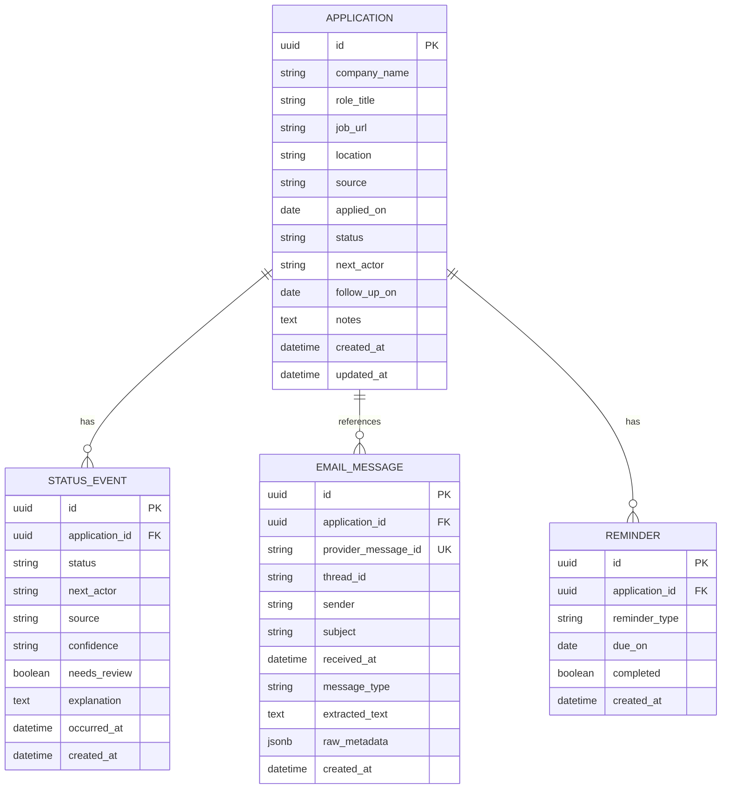
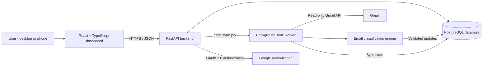
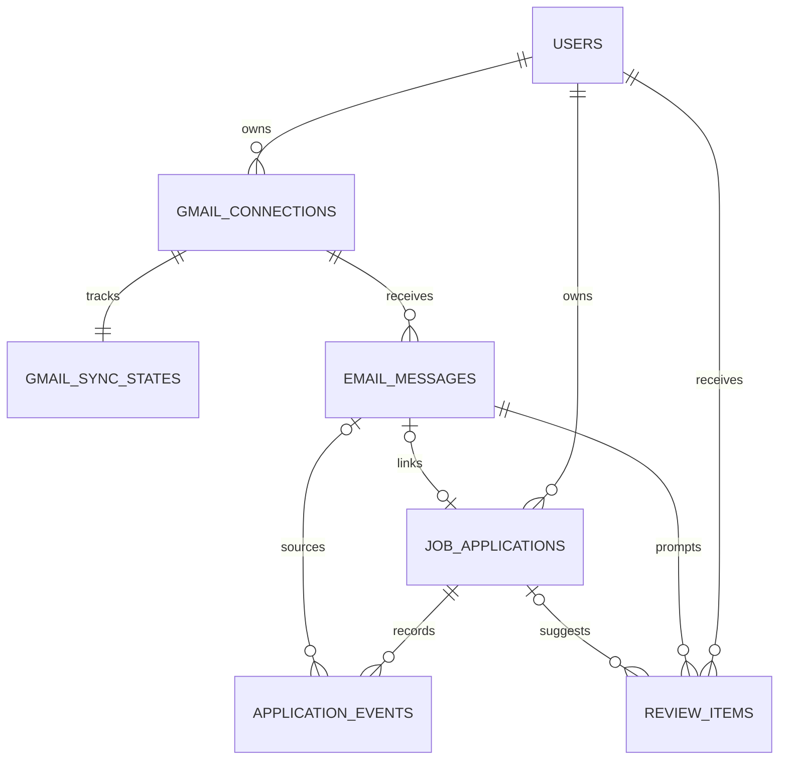
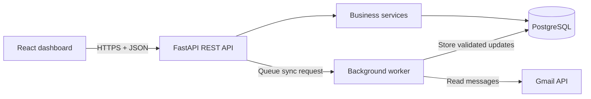
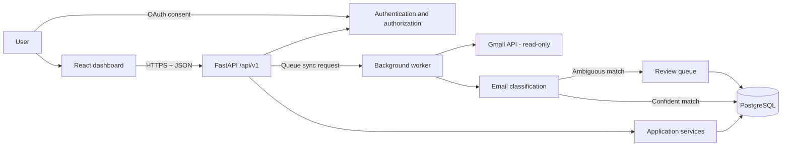

# JobTrack Phase 1: Planning and Architecture

## 1. Product scope

JobTrack is a personal job application tracker. It provides one dashboard for applications entered manually and, in later phases, discovered from Gmail through Google's official read-only API.

### Phase 5 target

A user can:

- Create an application with company, role, job URL, location, source, applied date, notes, and current status.
- View, search, filter, sort, edit, and delete applications.
- View an application's status timeline and email evidence.
- See dashboard counts for total applications, waiting for reply, assessments, interviews, and final outcomes.
- Record who needs to act next and any follow-up date.

### Explicitly out of scope until later phases

- Gmail OAuth and mailbox access.
- Automatic email classification or status changes.
- Notifications and background jobs.
- Multi-user accounts and team sharing.
- AI-generated summaries.
- Resume and document storage.

### Step 1 requirements baseline

The MVP includes all six proposed core requirements:

1. **Gmail integration**: securely connect one Gmail account through Google OAuth with read-only email access.
2. **Automatic application discovery**: identify job application confirmation emails and create application records.
3. **Application status tracking**: track waiting, recruiter callbacks, assessments, interview rounds, offers, rejections, and withdrawals.
4. **Interactive dashboard**: view applications, filter by status, search companies, and inspect progress.
5. **Manual corrections**: add missing applications, correct imported data, and record completed interviews manually.
6. **Email synchronization**: discover new relevant messages, update matching applications, and prevent duplicate imports.

The first usable milestone is the manual tracker in Phase 5. Gmail integration and automated discovery are specified now but remain disabled until the later integration phases. This keeps the core dashboard testable without requiring Google credentials.

### Step 1 checkpoint

- Requirements selected: **6 of 6**.
- Decision: **confirmed**.
- Next step: define the React, FastAPI, PostgreSQL, and Gmail communication architecture.

## 2. Status model

Statuses are ordered by applicant progress, but the workflow is not required to move forward monotonically. A user may correct an entry, and an employer may move an application from an interview back to waiting for a decision.

| Status                 | Meaning                                                         | Typical next actor    |
| ---------------------- | --------------------------------------------------------------- | --------------------- |
| `applied`              | Application submitted; submission confirmation may be recorded. | Employer              |
| `waiting_for_response` | No new employer action has been recorded.                       | Employer              |
| `recruiter_screening`  | Recruiter contact or an initial screening call exists.          | Applicant or employer |
| `assessment`           | An assessment was requested, is in progress, or was submitted.  | Applicant or employer |
| `interview`            | At least one interview is scheduled or completed.               | Applicant or employer |
| `offer`                | An offer was received.                                          | Applicant             |
| `rejected`             | Employer rejected the application.                              | None                  |
| `withdrawn`            | Applicant withdrew the application.                             | None                  |

`next_actor` is separate from `status` and has only two values: `applicant` and `employer`. A status update must never imply that an applicant completed an action. For example, an assessment request records `status=assessment` and `next_actor=applicant`; it does not record a completed assessment unless evidence or an explicit user action supports it.

The status timeline preserves repeated or skipped stages. The initial status is `applied`; later events may represent waiting, recruiter contact, an assessment request or completion, interview rounds, and a final outcome. An assessment invitation alone is evidence that an assessment was requested, not that it was completed.

### Status transition rules

- A new application starts at `applied`.
- Manual edits may set any valid status.
- Gmail automation may suggest a status and create an evidence event, but must not silently overwrite a user-confirmed status.
- Every status change creates a status event with its source: `manual`, `gmail`, or `system`.
- Terminal outcomes (`offer`, `rejected`, `withdrawn`) remain terminal until a user explicitly corrects them.
- Duplicate email evidence must be ignored using the provider message ID.
- A status event may be marked `needs_review` when the classifier is uncertain.

## 3. Core data model



### Entity constraints

- `company_name`, `role_title`, and `applied_on` are required.
- `status`, `next_actor`, and event `source` use controlled enum values.
- `provider_message_id` is unique when present.
- Deleting an application deletes its status events, email references, and reminders.
- Timestamps are stored in UTC; dates represent the user's calendar date.
- Email raw content is not required for Phase 5 and must be protected when Gmail integration is added.

## 4. API architecture

The backend exposes versioned REST endpoints under `/api/v1`. FastAPI owns validation and serialization; SQLAlchemy owns persistence; Alembic owns schema migrations.

### Health

- `GET /health` -> service health and version metadata.

### Applications

- `GET /api/v1/applications` -> paginated list with `status`, `next_actor`, `query`, `company`, `sort`, and date filters.
- `POST /api/v1/applications` -> create an application and initial status event.
- `GET /api/v1/applications/{id}` -> application details, timeline, and email evidence.
- `PATCH /api/v1/applications/{id}` -> update editable fields and create an event when status changes.
- `DELETE /api/v1/applications/{id}` -> delete an application.
- `POST /api/v1/applications/{id}/status-events` -> record a manual status event.

### Dashboard

- `GET /api/v1/dashboard/summary` -> total applied, waiting for response, assessments, interviews, and outcome counts.
- `GET /api/v1/dashboard/recent` -> recent applications ordered by update time.

### Future integration boundary

- `POST /api/v1/integrations/gmail/connect` -> OAuth flow entry point.
- `POST /api/v1/integrations/gmail/sync` -> incremental sync trigger.
- `GET /api/v1/integrations/gmail/status` -> connection and sync state.

These integration routes remain unimplemented until Phase 6. No Gmail credentials or access tokens belong in the application table.

## Phase 1 - Step 2: System Architecture

JobTrack uses three application components, supported by PostgreSQL: a React frontend, a FastAPI backend, and a background synchronization worker. A classification engine runs as part of the worker's processing pipeline.

### Architecture diagram



The dashboard reads from PostgreSQL through FastAPI, not directly from Gmail on every page load. This keeps the interface responsive and preserves manually entered information. The frontend never accesses database credentials, Gmail tokens, or the Gmail API directly.

### Component responsibilities

| Component             | Responsibility                                                                  |
| --------------------- | ------------------------------------------------------------------------------- |
| React + TypeScript    | Dashboard, search, filters, application details, and manual updates.            |
| FastAPI               | Authentication, application APIs, business rules, and synchronization requests. |
| PostgreSQL            | Applications, email references, status timelines, review items, and sync state. |
| Gmail API             | Read authorized emails and expose recruitment activity.                         |
| Background worker     | Initial import and scheduled incremental email checks.                          |
| Classification engine | Identify application emails, stages, employers, and uncertain changes.          |

### Communication flows

#### Flow A - Opening the dashboard

1. React requests dashboard data from FastAPI.
2. FastAPI queries PostgreSQL for applications, statistics, and timelines.
3. FastAPI returns validated JSON.
4. React renders the dashboard from that response.

#### Flow B - Connecting Gmail

1. The user selects **Connect Gmail**.
2. FastAPI initiates Google's OAuth authorization flow.
3. Google returns an authorization code to the backend callback.
4. The backend exchanges the code for credentials and stores the necessary tokens securely.
5. Gmail tokens are never exposed to the frontend.

#### Flow C - Synchronizing applications

1. The worker retrieves new or changed email information from Gmail.
2. The classification engine identifies job-related messages and extracts evidence.
3. The worker matches messages with existing applications using stable identifiers and matching rules.
4. Verified changes are recorded as email evidence and status events.
5. Uncertain matches or status changes are placed in a review queue.

#### Flow D - Manual updates

1. The user marks an assessment or interview completed, or corrects an application.
2. FastAPI validates the requested change against the domain rules.
3. PostgreSQL stores the current application state and appends a status-history event.
4. Later synchronization must not silently overwrite a user-confirmed manual update.

### Initial database entities

The entities below define the architecture boundary. Individual columns, indexes, foreign keys, and constraints are finalized in Phase 1, Step 3.

| Entity           | Stores                                                                      |
| ---------------- | --------------------------------------------------------------------------- |
| User             | Application owner and account information.                                  |
| GmailConnection  | Google connection metadata and encrypted credentials.                       |
| GmailSyncState   | Last successful sync, history cursor, and sync status.                      |
| EmailMessage     | Gmail message identifiers, relevant metadata, and classification evidence.  |
| JobApplication   | Company, role, application date, and current status.                        |
| ApplicationEvent | Status changes, interview rounds, assessment events, and their sources.     |
| ReviewItem       | Email classifications or proposed changes that require manual confirmation. |

This structure supports multiple interview rounds, duplicate prevention, historical tracking, and explicit ownership for the initial one-user design.

### Gmail synchronization design

- The initial import window is configurable, with 90 days as the starting default.
- Subsequent checks use Gmail's incremental history API.
- If the saved history cursor expires, the worker performs a recovery synchronization.
- While the backend and worker are running, the initial target is a configurable 15-minute interval.
- The dashboard exposes a **Sync Now** action that requests a synchronization job.
- Real-time push notifications are deferred because Google's push model requires Cloud Pub/Sub configuration.

### Step 2 architecture rules

1. **Privacy**: Gmail tokens remain server-side and encrypted at rest. Request only necessary permissions, and avoid storing full email bodies unless required. Gmail read-only is a restricted OAuth scope, so public deployment may require Google's verification and additional compliance.
2. **Reliable tracking**: Every significant status change receives a timeline event. Repeated and skipped interview stages are supported.
3. **Accuracy**: An invitation never automatically marks a stage completed. Uncertain updates require review.
4. **Synchronization**: Reprocessing the same Gmail message must not create duplicate applications or events.
5. **Future expansion**: Start with one user and one Gmail account, while keeping account ownership explicit in the data model.

### Step 2 checkpoint

- Architecture and component responsibilities: **complete**.
- Dashboard, OAuth, synchronization, and manual-update flows: **complete**.
- Initial database entities: **complete**.
- Security and Gmail synchronization decisions: **complete**.
- Decision: **confirmed**.
- Next step: define the concrete database tables, columns, relationships, constraints, and status-history model.

## Phase 1 - Step 3: Database Design

PostgreSQL is the system of record. All tables use UUID primary keys unless noted otherwise, and all timestamps use `TIMESTAMPTZ` with UTC conventions.

### Entity relationship diagram



An email belongs to at most one application in the MVP. Ambiguous matches are sent to review instead of being automatically linked.

### Table schemas

#### 1. `users`

| Column         | Type         | Rules                              |
| -------------- | ------------ | ---------------------------------- |
| `id`           | UUID         | Primary key.                       |
| `email`        | VARCHAR(320) | Required; case-insensitive unique. |
| `display_name` | VARCHAR(200) | Optional.                          |
| `created_at`   | TIMESTAMPTZ  | Required.                          |
| `updated_at`   | TIMESTAMPTZ  | Required.                          |

Ownership is retained even though the initial product is designed for one user.

#### 2. `gmail_connections`

| Column                      | Type         | Rules                                                           |
| --------------------------- | ------------ | --------------------------------------------------------------- |
| `id`                        | UUID         | Primary key.                                                    |
| `user_id`                   | UUID         | Required foreign key to `users`.                                |
| `google_subject`            | VARCHAR(255) | Stable Google account identifier.                               |
| `email_address`             | VARCHAR(320) | Required.                                                       |
| `encrypted_refresh_token`   | BYTEA        | Encrypted; nullable.                                            |
| `granted_scopes`            | TEXT[]       | Required.                                                       |
| `connection_status`         | VARCHAR(30)  | Required: `CONNECTED`, `RECONNECT_REQUIRED`, or `DISCONNECTED`. |
| `created_at` / `updated_at` | TIMESTAMPTZ  | Required.                                                       |
| `disconnected_at`           | TIMESTAMPTZ  | Optional.                                                       |

For MVP, a partial unique index permits only one active connection per user. Tokens are never stored in plaintext or returned to React.

#### 3. `gmail_sync_states`

| Column                                        | Type        | Rules                                               |
| --------------------------------------------- | ----------- | --------------------------------------------------- |
| `gmail_connection_id`                         | UUID        | Primary key and foreign key to `gmail_connections`. |
| `last_history_id`                             | VARCHAR(64) | Nullable Gmail history cursor.                      |
| `sync_status`                                 | VARCHAR(20) | Required: `IDLE`, `RUNNING`, or `FAILED`.           |
| `backfill_after`                              | TIMESTAMPTZ | Optional initial-import boundary.                   |
| `last_attempt_at` / `last_successful_sync_at` | TIMESTAMPTZ | Optional.                                           |
| `last_error_message`                          | TEXT        | Optional; must not contain tokens or email bodies.  |

The cursor advances only after a batch succeeds, preventing missed messages after partial failure.

#### 4. `email_messages`

| Column                                 | Type         | Rules                                        |
| -------------------------------------- | ------------ | -------------------------------------------- |
| `id`                                   | UUID         | Primary key.                                 |
| `gmail_connection_id`                  | UUID         | Required foreign key to `gmail_connections`. |
| `gmail_message_id` / `gmail_thread_id` | VARCHAR(255) | Required Gmail identifiers.                  |
| `job_application_id`                   | UUID         | Nullable foreign key to `job_applications`.  |
| `sender_address`                       | VARCHAR(320) | Optional.                                    |
| `subject`                              | TEXT         | Optional.                                    |
| `received_at`                          | TIMESTAMPTZ  | Required.                                    |
| `classification_kind`                  | VARCHAR(40)  | Required classification or `UNKNOWN`.        |
| `processing_status`                    | VARCHAR(30)  | Required processing state.                   |
| `processed_at` / `created_at`          | TIMESTAMPTZ  | Optional / required.                         |

`(gmail_connection_id, gmail_message_id)` is unique. Complete bodies and attachments are not retained by default.

#### 5. `job_applications`

| Column                       | Type         | Rules                                    |
| ---------------------------- | ------------ | ---------------------------------------- |
| `id`                         | UUID         | Primary key.                             |
| `user_id`                    | UUID         | Required foreign key to `users`.         |
| `company_name` / `job_title` | VARCHAR(255) | Required.                                |
| `job_url`                    | TEXT         | Optional.                                |
| `location`                   | VARCHAR(255) | Optional.                                |
| `applied_at`                 | DATE         | Optional.                                |
| `application_source`         | VARCHAR(20)  | Required: `MANUAL` or `EMAIL`.           |
| `current_stage`              | VARCHAR(30)  | Required pipeline stage.                 |
| `next_action_owner`          | VARCHAR(20)  | Required: `USER`, `EMPLOYER`, or `NONE`. |
| `notes`                      | TEXT         | Optional.                                |
| `last_activity_at`           | TIMESTAMPTZ  | Required.                                |
| `created_at` / `updated_at`  | TIMESTAMPTZ  | Required.                                |

There is no unique constraint on company and title because multiple applications to the same employer are valid.

#### 6. `application_events`

| Column                        | Type         | Rules                                       |
| ----------------------------- | ------------ | ------------------------------------------- |
| `id`                          | UUID         | Primary key.                                |
| `job_application_id`          | UUID         | Required foreign key to `job_applications`. |
| `source_email_message_id`     | UUID         | Nullable foreign key to `email_messages`.   |
| `event_kind`                  | VARCHAR(50)  | Required event type.                        |
| `interview_round`             | INTEGER      | Optional; positive when present.            |
| `origin`                      | VARCHAR(20)  | Required: `MANUAL`, `GMAIL`, or `SYSTEM`.   |
| `verified_by_user`            | BOOLEAN      | Required; defaults to `false`.              |
| `details`                     | JSONB        | Optional structured evidence.               |
| `idempotency_key`             | VARCHAR(255) | Required.                                   |
| `occurred_at` / `recorded_at` | TIMESTAMPTZ  | Required.                                   |

Supported events include `APPLICATION_SUBMITTED`, `RECRUITER_CONTACTED`, `ASSESSMENT_INVITED`, `ASSESSMENT_COMPLETED`, `INTERVIEW_SCHEDULED`, `INTERVIEW_COMPLETED`, `OFFER_RECEIVED`, `REJECTION_RECEIVED`, and `MANUAL_CORRECTION`. `(job_application_id, idempotency_key)` is unique.

#### 7. `review_items`

| Column                       | Type         | Rules                                            |
| ---------------------------- | ------------ | ------------------------------------------------ |
| `id`                         | UUID         | Primary key.                                     |
| `user_id`                    | UUID         | Required foreign key to `users`.                 |
| `email_message_id`           | UUID         | Required foreign key to `email_messages`.        |
| `suggested_application_id`   | UUID         | Nullable foreign key to `job_applications`.      |
| `suggested_event_kind`       | VARCHAR(50)  | Optional.                                        |
| `confidence`                 | NUMERIC(4,3) | Required; between 0 and 1.                       |
| `reason`                     | TEXT         | Required.                                        |
| `review_status`              | VARCHAR(20)  | Required: `PENDING`, `APPROVED`, or `DISMISSED`. |
| `created_at` / `resolved_at` | TIMESTAMPTZ  | Required / optional.                             |

### Allowed stages, events, and integrity rules

- Pipeline stages: `APPLIED`, `SCREENING`, `ASSESSMENT`, `INTERVIEW`, `OFFER`, `REJECTED`, `WITHDRAWN`.
- Action ownership: `USER` means the applicant must act, `EMPLOYER` means waiting for the company, and `NONE` means no action is pending.
- PostgreSQL `CHECK` constraints enforce controlled values, confidence range `0 <= confidence <= 1`, and positive interview rounds.
- Foreign keys enforce ownership and referential integrity; API queries are always user-scoped.
- Indexes cover user ownership, application dates, current stages, foreign keys, Gmail identifiers, and pending review lookups.
- A partial unique index allows at most one `PENDING` review item for the same email message.
- UUID primary keys enforce record identity; unique constraints prevent duplicate Gmail messages and duplicate event processing.

### Relationships and deletion behavior

- One user owns many Gmail connections, applications, and review items.
- One Gmail connection has exactly one sync state and many email messages.
- One application has many events; an email may be linked to zero or one application.
- Deleting an application deletes its application events. Linked email records are retained and their application reference is set to `NULL`.
- Disconnecting Gmail does not delete applications or history. Intentional user data deletion is a separate explicit operation.
- Cascading deletion must not remove Gmail connection history accidentally.

### Example application timeline

1. **Oct 8 - Application submitted**: confirmed through an application email.
2. **Oct 11 - Assessment invited**: action required from the applicant.
3. **Oct 13 - Assessment completed**: manually confirmed.
4. **Oct 16 - Interview Round 1 scheduled**: identified from a recruiter email.

The current stage is `INTERVIEW`, but Round 1 is scheduled, not completed. A separate explicit `INTERVIEW_COMPLETED` event is required. History is append-only by default; corrections create new events rather than modifying evidence.

### Privacy and manual override rules

- Emails may suggest progress, but completion requires suitable evidence or explicit user confirmation.
- Manual updates are marked as user-verified and cannot be silently overwritten by synchronization.
- Skipped and repeated stages are represented by events, including an interview round number where relevant.
- Reprocessing a Gmail message or event uses the unique identifiers above and is idempotent.
- Uncertain job-to-email matches create review items instead of unreliable application records.
- Refresh tokens remain encrypted and server-side; email bodies and attachments are not retained unless a later feature explicitly requires them.

### Step 3 checkpoint

- All seven tables and columns documented: **complete**.
- Relationships and foreign keys documented: **complete**.
- Unique constraints and indexes documented: **complete**.
- Status/event model and manual override rules documented: **complete**.
- Deletion behavior and privacy rules documented: **complete**.
- Decision: **confirmed**.
- Next step: define the REST API contract, request/response structures, authentication requirements, and errors.

## Phase 1 - Step 4: REST API Contract

### API structure and conventions

All application endpoints use the versioned prefix `/api/v1`. Requests and responses are JSON, identifiers are UUIDs, fields use `snake_case`, and timestamps use ISO 8601 in UTC. FastAPI will expose the resulting OpenAPI specification and interactive documentation.



### Authentication and Gmail connection APIs

| Method   | Endpoint                   | Purpose                                                      |
| -------- | -------------------------- | ------------------------------------------------------------ |
| `GET`    | `/auth/google/start`       | Begin Google authorization.                                  |
| `GET`    | `/auth/google/callback`    | Validate state and complete the authorization-code exchange. |
| `GET`    | `/auth/me`                 | Return the current signed-in user.                           |
| `POST`   | `/auth/logout`             | End the application session.                                 |
| `GET`    | `/api/v1/gmail/connection` | Return Gmail connection status, never credentials.           |
| `DELETE` | `/api/v1/gmail/connection` | Disconnect Gmail without deleting application history.       |

Google OAuth uses a server-side authorization-code flow with validated state and configured redirect URIs. The frontend uses a secure `HttpOnly` session cookie, with CSRF protection on state-changing requests. The application session is separate from Gmail access credentials. Gmail requests `gmail.readonly` plus the identity scopes needed for sign-in; refresh tokens remain encrypted and server-side.

### Job application APIs

| Method   | Endpoint                           | Purpose                                                |
| -------- | ---------------------------------- | ------------------------------------------------------ |
| `GET`    | `/api/v1/applications`             | List, search, filter, sort, and paginate applications. |
| `POST`   | `/api/v1/applications`             | Create an application manually.                        |
| `GET`    | `/api/v1/applications/{id}`        | Retrieve application details.                          |
| `PATCH`  | `/api/v1/applications/{id}`        | Edit descriptive application information.              |
| `DELETE` | `/api/v1/applications/{id}`        | Delete an application and its events.                  |
| `GET`    | `/api/v1/applications/{id}/events` | Retrieve the progress timeline.                        |
| `POST`   | `/api/v1/applications/{id}/events` | Record a manual progress event.                        |
| `GET`    | `/api/v1/applications/{id}/emails` | View linked email metadata.                            |

The list endpoint supports `q` for company or title search, `stage`, `next_action_owner`, `page`, and `page_size`. `page_size` is capped at 100. Results sort by recent activity with UUID as a stable tie-breaker. Every query is scoped to the authenticated user.

#### Create application request and response

```http
POST /api/v1/applications
Content-Type: application/json
```

```json
{
  "company_name": "Example Technologies",
  "job_title": "Backend Software Engineer",
  "location": "Boston, MA",
  "applied_at": "2026-10-19",
  "job_url": null,
  "notes": "Applied through the company website"
}
```

```json
{
  "id": "b6cc80b0-c8fc-40fc-a9ea-6f14c1c875c1",
  "company_name": "Example Technologies",
  "job_title": "Backend Software Engineer",
  "application_source": "MANUAL",
  "current_stage": "APPLIED",
  "next_action_owner": "EMPLOYER",
  "applied_at": "2026-10-19",
  "created_at": "2026-10-20T14:00:00Z"
}
```

The response status is `201 Created`. The backend assigns ownership, `application_source`, and the initial stage; clients cannot impersonate another user or set the source.

#### List applications response

```http
GET /api/v1/applications?stage=APPLIED&page=1&page_size=20
```

```json
{
  "items": [
    {
      "id": "b6cc80b0-c8fc-40fc-a9ea-6f14c1c875c1",
      "company_name": "Example Technologies",
      "job_title": "Backend Software Engineer",
      "current_stage": "APPLIED",
      "next_action_owner": "EMPLOYER",
      "applied_at": "2026-10-19"
    }
  ],
  "page": 1,
  "page_size": 20,
  "total": 1
}
```

### Application progress APIs

Descriptive edits and progress changes are separate operations. `PATCH /applications/{id}` cannot directly overwrite `current_stage`; progress is represented by an append-only event.

```http
POST /api/v1/applications/{id}/events
Content-Type: application/json
```

```json
{
  "event_kind": "ASSESSMENT_COMPLETED",
  "occurred_at": "2026-10-20T14:00:00Z",
  "client_request_id": "74f83183-51b2-4146-b5a2-cfbcd2de32c6",
  "details": {
    "note": "Submitted through assessment portal"
  }
}
```

The response is `201 Created` and includes the new event plus the updated application summary. The backend sets `origin=MANUAL` and `verified_by_user=true`. Reusing the same `client_request_id` with identical content returns the existing event; reusing it for different content returns `409 Conflict`. The current stage and next-action owner are derived from event history, allowing an assessment to be completed while the application waits for the employer.

### Gmail synchronization APIs

| Method | Endpoint                    | Purpose                                        |
| ------ | --------------------------- | ---------------------------------------------- |
| `POST` | `/api/v1/gmail/sync`        | Request an asynchronous email synchronization. |
| `GET`  | `/api/v1/gmail/sync-status` | Return worker progress and sync state.         |

```http
POST /api/v1/gmail/sync
```

```json
{
  "sync_status": "RUNNING",
  "message": "Synchronization accepted"
}
```

The response is `202 Accepted`; it does not claim that synchronization has finished. If a synchronization is already active, the API returns `409 Conflict`. The worker uses Gmail history and the persisted cursor, performs recovery synchronization when the cursor expires, and advances the cursor only after successful processing. Worker functions are never unauthenticated public endpoints.

```json
{
  "sync_status": "IDLE",
  "last_successful_sync_at": "2026-10-20T14:10:00Z",
  "last_attempt_at": "2026-10-20T14:09:00Z"
}
```

### Dashboard and review APIs

| Method | Endpoint                       | Purpose                                      |
| ------ | ------------------------------ | -------------------------------------------- |
| `GET`  | `/api/v1/dashboard/summary`    | Return aggregated dashboard counts.          |
| `GET`  | `/api/v1/reviews`              | List uncertain classifications for the user. |
| `GET`  | `/api/v1/reviews/{id}`         | Get review details.                          |
| `POST` | `/api/v1/reviews/{id}/approve` | Approve a proposed update transactionally.   |
| `POST` | `/api/v1/reviews/{id}/dismiss` | Dismiss a proposed update.                   |

Example summary:

```json
{
  "total_applications": 48,
  "waiting_for_employer": 29,
  "action_required": 7,
  "assessments_pending": 5,
  "interviews_upcoming": 3,
  "offers": 1,
  "pending_reviews": 2
}
```

Counts may overlap and must not be added together to derive the total. Approving a review validates ownership, links the email, creates the appropriate timeline event, and marks the review approved in one transaction. If there is no confirmed application match, the user must choose an existing application or create one manually.

### Validation, response, and error contract

All errors use a stable JSON envelope:

```json
{
  "error": {
    "code": "APPLICATION_NOT_FOUND",
    "message": "Application not found",
    "details": null
  }
}
```

| HTTP status | Meaning                                                          |
| ----------- | ---------------------------------------------------------------- |
| `200`       | Successful read or update.                                       |
| `201`       | New record created.                                              |
| `202`       | Background work accepted.                                        |
| `204`       | Successful deletion or logout.                                   |
| `400`       | Invalid operation or request.                                    |
| `401`       | Authentication required.                                         |
| `403`       | Authenticated user is not permitted.                             |
| `404`       | Resource not found.                                              |
| `409`       | Conflict, duplicate, active sync, or invalid workflow operation. |
| `422`       | Field validation failure.                                        |
| `429`       | Rate limit exceeded.                                             |
| `503`       | Temporary service unavailability.                                |

FastAPI/Pydantic validates required fields, UUIDs, enum values, dates, timestamp formats, pagination bounds, and event-specific fields such as positive interview rounds. Internal exception details, OAuth credentials, email bodies, and authorization headers are never returned.

### Final API contract decisions

1. All application endpoints are authenticated and user-scoped.
2. React communicates only with FastAPI; it never accesses PostgreSQL or Gmail tokens directly.
3. Application stage changes are represented by timeline events.
4. Gmail synchronization is asynchronous and idempotent.
5. Uncertain email classifications require explicit review.

### Step 4 checkpoint

- Authentication and Gmail connection APIs documented: **complete**.
- Job application CRUD, filtering, and pagination APIs documented: **complete**.
- Application events and manual-update behavior documented: **complete**.
- Review and dashboard APIs documented: **complete**.
- Request/response examples, errors, and security rules documented: **complete**.
- Decision: **confirmed**.
- Next step: final architecture review and project structure.

## Phase 1 - Step 5: Final Architecture Review & Project Structure

### Final technology stack

| Layer                 | Technology              |
| --------------------- | ----------------------- |
| Frontend              | React, TypeScript, Vite |
| Styling               | Tailwind CSS            |
| Backend               | Python, FastAPI         |
| API validation        | Pydantic                |
| Database              | PostgreSQL              |
| ORM                   | SQLAlchemy 2.x          |
| Database migrations   | Alembic                 |
| Authentication        | Google OAuth 2.0        |
| Email integration     | Gmail API               |
| Background processing | Dedicated Python worker |
| Testing               | Pytest, Vitest          |
| Containerization      | Docker Compose          |
| Version control       | Git + GitHub            |

The first version uses database-backed scheduling and polling. Redis and a task queue remain future scaling options rather than Phase 2 dependencies.

### Final monorepo structure

```text
jobtrack/
├── backend/
│   ├── app/
│   │   ├── main.py
│   │   ├── api/v1/
│   │   │   ├── auth.py
│   │   │   ├── applications.py
│   │   │   ├── events.py
│   │   │   ├── gmail.py
│   │   │   ├── reviews.py
│   │   │   └── dashboard.py
│   │   ├── core/
│   │   │   ├── config.py
│   │   │   └── security.py
│   │   ├── db/
│   │   │   ├── base.py
│   │   │   └── session.py
│   │   ├── models/
│   │   ├── schemas/
│   │   ├── services/
│   │   ├── integrations/gmail/
│   │   └── workers/
│   ├── alembic/
│   ├── tests/
│   └── requirements.txt
├── frontend/
│   ├── src/
│   │   ├── api/
│   │   ├── components/
│   │   ├── pages/
│   │   ├── hooks/
│   │   ├── types/
│   │   └── App.tsx
│   └── package.json
├── docs/
│   └── phase-1-architecture.md
├── .env.example
├── .gitignore
├── docker-compose.yml
└── README.md
```

The structure separates routing, business logic, persistence, Gmail integration, worker processing, and frontend presentation. Directories will be created incrementally in Phase 2; empty future files are not required now.

### Final system communication review



The worker never treats an assessment invitation as completion. Ambiguous email matches remain pending until review. The dashboard reads the database through FastAPI rather than querying Gmail directly.

### Reconciled architecture decisions

| Area                | Final decision                                                                                          |
| ------------------- | ------------------------------------------------------------------------------------------------------- |
| Authentication      | Server-side session with secure `HttpOnly` cookies and CSRF protection.                                 |
| Gmail authorization | Separate Gmail mailbox permission handling from JobTrack sign-in; sign-in is not consent to read email. |
| Ownership           | Every application and related record is scoped to the authenticated user.                               |
| Event history       | Append-only events with idempotency keys.                                                               |
| Manual updates      | User-confirmed changes are never silently overwritten by email automation.                              |
| Email matching      | Uncertain matches go to the review queue.                                                               |
| Synchronization     | Configurable initial import, incremental sync, and cursor-expiry recovery.                              |
| Scheduling          | Durable database-backed scheduling and locking prevent overlapping jobs after restarts.                 |
| Time handling       | Store timestamps in UTC and display them in the user's local timezone.                                  |
| Database migration  | All schema changes are Alembic-managed.                                                                 |
| API contracts       | Versioned `/api/v1` JSON endpoints with consistent errors.                                              |

### Phase 2 implementation sequence

1. **Create the repository**: create the `jobtrack` folder, initialize Git, and open it in VS Code.
2. **Backend foundation**: create the Python virtual environment, install FastAPI, and add a health endpoint.
3. **Frontend foundation**: initialize React, TypeScript, and Vite, then launch the development server.
4. **Frontend/backend communication**: connect React to the FastAPI health endpoint.
5. **Configuration and verification**: configure environment variables, CORS, `.gitignore`, basic tests, and the initial Git commit.

The first Phase 2 milestone is a JobTrack development dashboard with a running frontend and healthy backend. No Gmail credentials or production services are required for this milestone.

### Step 5 final checkpoint

- Technology stack finalized: **complete**.
- Monorepo folder structure documented: **complete**.
- Communication diagram reviewed: **complete**.
- Authentication, synchronization, and event rules reconciled: **complete**.
- Phase 2 implementation order documented: **complete**.
- Decision: **confirmed**.
- Phase 1 status: **complete**.

## 6. Initial repository structure

```text
jobtrack/
├── backend/
│   ├── app/
│   │   ├── api/v1/
│   │   ├── core/
│   │   ├── db/
│   │   ├── models/
│   │   ├── schemas/
│   │   ├── services/
│   │   └── main.py
│   ├── alembic/
│   ├── tests/
│   ├── pyproject.toml
│   └── .env.example
├── frontend/
│   ├── src/
│   │   ├── api/
│   │   ├── components/
│   │   ├── features/applications/
│   │   ├── pages/
│   │   ├── types/
│   │   └── App.tsx
│   ├── public/
│   ├── package.json
│   └── .env.example
├── docs/
│   └── phase-1-architecture.md
├── .gitignore
└── README.md
```

## 7. Security and operational decisions

- Local development uses environment variables and committed `.env.example` files only; secrets are never committed.
- Gmail access will request the smallest practical scope and remain read-only.
- OAuth tokens will be encrypted at rest and excluded from API responses.
- API input is validated server-side; frontend validation is for usability only.
- Logs must not include email bodies, OAuth tokens, or authorization headers.
- Database migrations are required for every schema change.
- All destructive operations require an explicit API action; email synchronization is read-only.

## 8. Phase exit criteria

Phase 1 is complete when:

- Requirements and non-goals are documented.
- Status definitions and transition rules are explicit.
- The normalized data model supports manual records and future Gmail evidence.
- API responsibilities and the Gmail integration boundary are defined.
- The initial repository structure and security decisions are recorded.

Phase 2 begins with project scaffolding, local configuration, and a running FastAPI health endpoint plus React shell.
