# JobTrack - Phase 11 Job Discovery Architecture

## Status

Phase 11 Step 1 architecture baseline. This document defines the boundaries and first implementation direction for job discovery and application preparation. It does not add tables, endpoints, migrations, external integrations, or application data.

## 1. Goals and Non-Goals

### Goals

- Discover legitimate public software and Oracle CPQ opportunities.
- Preserve the source URL, provider identity, retrieval time, and original listing content needed for traceability.
- Normalize listings and deduplicate repeated observations of the same opportunity.
- Match opportunities against user-controlled preferences and truthful profile information.
- Prepare application materials for explicit user review.
- Keep discovery, preparation, approval, and confirmed submission as separate states.

### Non-goals for the first implementation

- Automated job applications or browser submission.
- Claims that an application was submitted because a link was opened.
- Scraping sites where access is prohibited, bypassing authentication, or bypassing anti-bot controls.
- Inferring work authorization, sponsorship, qualifications, dates, or experience that the user has not provided.
- Automatic mutation of existing `job_applications`, Gmail reviews, or application events during discovery.

## 2. Existing System Boundary

The current SQLAlchemy model contains these relevant bounded areas:

- `users`: authenticated ownership root.
- `job_applications`: the user's existing application tracking records.
- `application_events`: confirmed application timeline events with idempotency and workflow rules.
- `gmail_connections`, `email_messages`, and `review_items`: metadata-only Gmail intelligence and explicit review decisions.
- Authentication/session and CSRF controls: existing API protection used by state-changing routes.

Current API routers cover authentication, applications, application events, Gmail, and review items. There is no existing job opportunity, source, matching, preparation, or document endpoint. Phase 11 should therefore introduce a separate discovery API rather than overload the application-tracking or Gmail-review endpoints.

The existing `job_applications` table remains the record of an application the user has actually created or confirmed. A discovered opportunity must not be inserted into that table merely because it was found or ranked.

## 3. Pipeline

```mermaid
flowchart LR
    A[Public provider or user URL] --> B[Source adapter]
    B --> C[Validate and normalize listing]
    C --> D[Deduplicate opportunity]
    D --> E[Store source observation]
    E --> F[Match against user profile]
    F --> G[Rank with explanations]
    G --> H[User reviews opportunity]
    H --> I[Prepare truthful application package]
    I --> J[User approves package]
    J --> K[Open employer application site]
    K --> L[User completes submission]
    L --> M[Record confirmed submission only]
```

Each stage has a one-way responsibility:

1. Source adapters retrieve or accept public listing data.
2. Normalization creates a stable internal representation without changing the source meaning.
3. Deduplication groups repeated observations but preserves source provenance.
4. Matching produces explainable user-scoped results and never creates an application.
5. Preparation creates drafts and recommendations, not claims of submission.
6. Approval records explicit user intent before any external application action.
7. Submission confirmation is recorded only from an explicit user confirmation or a verified provider result.

## 4. Proposed Data Model

These are proposed additions, not migration instructions. Fields should be finalized alongside the first API contract and migration tests.

### `job_sources`

Represents an allowed provider or user-provided URL origin.

- `id`
- `owner_user_id` nullable for centrally configured public providers, non-null for private user imports
- `source_type` such as `API`, `FEED`, `USER_URL`
- `provider_key` stable internal provider identifier
- `base_url`
- `terms_url` or policy reference when available
- `enabled`
- `created_at`, `updated_at`

A source is metadata about where data came from. It is not an authorization to bypass provider controls. Provider adapters must enforce their own allowed retrieval method.

### `job_opportunities`

Canonical opportunity identity and normalized listing data.

- `id`
- `source_id`
- `external_job_id` nullable when a provider supplies a stable identifier
- `canonical_url`
- `title`
- `employer_name`
- `employer_key` normalized comparison key
- `description_text` or a constrained stored representation of the public description
- `location_text`
- `remote_type`
- `employment_type`
- `posted_at`
- `closing_at` nullable
- `work_authorization_text` nullable and explicitly unverified
- `content_hash`
- `first_seen_at`, `last_seen_at`
- `status` such as `ACTIVE`, `CLOSED`, `STALE`, `REJECTED_SOURCE`
- `created_at`, `updated_at`

The original URL and source reference are required. Descriptions are untrusted third-party input and must not be rendered as executable content or treated as system instructions.

### `job_observations`

Optional but recommended for source history and deduplication audit.

- `id`
- `opportunity_id`
- `source_id`
- `retrieved_at`
- `source_updated_at` nullable
- `observed_title`
- `observed_url`
- `observed_content_hash`
- `raw_metadata` constrained JSON metadata, excluding unnecessary secrets

This preserves changes to a listing without making every refresh a new opportunity.

### `job_matches`

A user-scoped, explainable ranking result.

- `id`
- `user_id`
- `opportunity_id`
- `match_version`
- `score` bounded from 0 to 1
- `match_status` such as `NEW`, `SAVED`, `DISMISSED`, `EXPIRED`
- `explanation` structured JSON containing positive and missing signals
- `matched_skills`, `missing_skills`, and `location_result`
- `authorization_result` with values such as `UNKNOWN`, `USER_CONFIRMED`, `SOURCE_STATED`
- `created_at`, `updated_at`

A match is a recommendation, not an application and not a qualification decision. Cross-user rows must be inaccessible through user-scoped queries.

### `application_preparations`

Draft preparation associated with one user and one opportunity.

- `id`
- `user_id`
- `opportunity_id`
- `job_match_id` nullable
- `status`: `DRAFT`, `READY_FOR_REVIEW`, `APPROVED`, `EXPIRED`, `CANCELLED`, `SUBMISSION_CONFIRMED`
- `truthfulness_check_status`
- `checklist` structured JSON
- `notes`
- `approved_at`, `approved_by` nullable
- `created_at`, `updated_at`

This entity must not create a `job_application` until the user explicitly confirms that an application was created or submitted through the employer workflow.

### `application_documents`

Versioned references to approved preparation materials.

- `id`
- `preparation_id`
- `user_id`
- `document_type` such as `RESUME`, `COVER_NOTE`, `ANSWER_DRAFT`
- `storage_reference` or content reference managed by the document boundary
- `version`
- `content_hash`
- `approval_status`
- `created_at`, `approved_at`

Never silently rewrite an approved document. A new version should be created and reviewed.

### Relationship to existing applications

Do not duplicate `job_applications` inside discovery tables. A preparation can reference an existing application only after the user intentionally links it. A confirmed application may later create or update the existing application-tracking workflow through an explicit command that uses the existing event and idempotency rules.

## 5. Source Strategy

### Initial source policy

Start with two supported input modes:

1. Provider API or feed adapters with documented access and stable identifiers.
2. User-provided public job URLs, parsed only when access is permitted and the page is publicly available.

The first adapter should be selected by a concrete provider contract, not by broad scraping. Each adapter should define request limits, authentication needs, attribution requirements, fields available, retention rules, and failure behavior.

### Source attribution

Every opportunity must retain:

- provider/source key
- original URL
- retrieval timestamp
- external identifier when available
- normalized content hash
- source update timestamp when available

When a provider cannot supply a stable ID, the system must label identity as heuristic and keep the canonical URL plus content hash for auditability.

### Retrieval safety

- Use explicit allowlisted hosts and schemes (`https` by default).
- Do not follow arbitrary redirects into unknown hosts without revalidation.
- Apply timeouts, response-size limits, and rate limits.
- Treat fetched content as untrusted data.
- Do not send Gmail tokens, session cookies, or other private credentials to job sources.
- Do not use the Gmail integration as a job-discovery source unless a future feature explicitly defines that boundary.

## 6. Deduplication Rules

Deduplication should be deterministic and source-aware:

1. Prefer `(source_id, external_job_id)` when the provider ID is stable.
2. Otherwise use a normalized canonical URL scoped to the source.
3. When URLs change, compare normalized employer, title, location, and content hash within a bounded time window.
4. Do not merge listings solely because employer and title are similar; preserve ambiguity when evidence is weak.
5. Store observations separately so changed descriptions and source updates remain traceable.
6. Treat a closed listing and a newly posted listing as distinct when the provider identifier or posting identity indicates a new opening.
7. Never deduplicate across users in a way that leaks private notes, match explanations, or preparation content. A shared public opportunity may be reused, but user-specific rows remain isolated.

Recommended database constraints will be finalized after the first provider contract. Candidate uniqueness includes a provider-scoped external identity, while heuristic identities require a documented conflict strategy rather than an over-broad unique index.

## 7. Matching and Ranking

Matching should begin with transparent deterministic signals:

- title and role-family alignment
- explicitly user-provided skills and technologies
- seniority compatibility
- location and remote preference
- employment type preference
- work-authorization information, kept separate from location
- freshness and source quality

The score must be accompanied by positive evidence, missing evidence, and unknowns. Unknown authorization must not be converted into eligibility. A job description must not create a qualification or sponsorship fact in the user's profile.

Initial target role priorities:

- Very high: Oracle CPQ Developer, Oracle CPQ Integration Developer
- Very high: Junior Software Engineer, Software Engineer I
- High: Java Developer, Spring Boot Developer
- High: Backend Software Engineer
- High: Associate Software Engineer
- High: Junior CPQ Consultant

Initial location preferences:

- Boston-area opportunities
- US remote opportunities

Location eligibility and work-authorization eligibility are separate result fields and separate user decisions.

## 8. API Boundaries

The API should be introduced under a new `/api/v1/job-discovery` boundary, with all authenticated reads and writes scoped by the current user.

Proposed read endpoints:

- `GET /job-discovery/sources`
- `GET /job-discovery/opportunities`
- `GET /job-discovery/opportunities/{id}`
- `GET /job-discovery/matches`
- `GET /job-discovery/matches/{id}`
- `GET /job-discovery/preparations/{id}`

Proposed commands:

- `POST /job-discovery/imports/url` to request a permitted public URL import
- `POST /job-discovery/refresh` to request a bounded source refresh
- `POST /job-discovery/matches/{id}/save`
- `POST /job-discovery/matches/{id}/dismiss`
- `POST /job-discovery/matches/{id}/prepare`
- `PATCH /job-discovery/preparations/{id}` for user-authored draft edits
- `POST /job-discovery/preparations/{id}/approve`
- `POST /job-discovery/preparations/{id}/submission-confirmation`

The first implementation should likely ship only one import command and opportunity list/detail reads. Matching and preparation should follow once the normalized opportunity contract is tested.

API rules:

- Use existing authenticated session and CSRF/origin protection for state-changing commands.
- Return source attribution and canonical employer-site links.
- Never expose another user's notes, match explanation, documents, or preparation.
- Validate URL schemes and hosts before retrieval.
- Use idempotency keys for import and confirmation commands.
- Approval endpoints must not perform an external submission implicitly.
- Submission confirmation must distinguish `LINK_OPENED`, `USER_CONFIRMED`, and any verified provider confirmation; only the latter two can advance application tracking, according to a future explicit contract.

## 9. Approval and Submission Safety

The safety boundary is explicit:

- Discovery is read/import only.
- Ranking recommends; it does not apply.
- Preparation drafts; it does not submit.
- Approval records user intent; it does not silently submit.
- External submission requires an employer-site interaction and explicit user action.
- JobTrack records a submission only after user confirmation or a verified employer/provider result.

Non-negotiable safeguards:

- Never invent qualifications, employment dates, compensation, sponsorship eligibility, or work authorization.
- Preserve user edits and approved document versions.
- Show the source URL and source attribution before approval.
- Keep third-party text untrusted and separate from system instructions.
- Reject cross-user opportunity, match, preparation, and document access.
- Make approval and confirmation idempotent.
- Keep the existing Gmail review and `job_applications` workflows intact.
- Do not mutate application stages from discovery or matching alone.

## 10. First Implementation Slice

Before creating migrations, finalize one provider/input contract and its retention rules. Then implement in this order:

1. Add model and migration tests for `job_sources`, `job_opportunities`, and source identity constraints.
2. Add a single source adapter or permitted user-URL import with bounded retrieval and attribution.
3. Add authenticated opportunity list/detail endpoints with ownership and source filters.
4. Add deterministic deduplication tests for stable IDs, canonical URLs, changed URLs, and stale listings.
5. Add a minimal discovery dashboard view without changing the existing application or review screens.
6. Add matching only after opportunity normalization is stable.
7. Add preparation and approval only after document versioning and truthfulness checks are specified.

No Phase 11 migration should be generated from this architecture document alone. The migration should follow the finalized fields and constraints of the first implementation slice.

## 11. Validation and Acceptance Criteria

Phase 11 Step 1 is complete when:

- Existing models, routers, and migrations have been reviewed.
- No existing table or endpoint is duplicated in the proposal.
- Source attribution and deduplication rules are explicit.
- User ownership boundaries are explicit for every new entity.
- Location and work authorization remain separate.
- Preparation and confirmed submission are separate states.
- No application data is modified by architecture work.
- No unrelated worktree changes are staged.

This document satisfies the architecture checkpoint. Implementation begins only after the first source contract is selected and reviewed.
